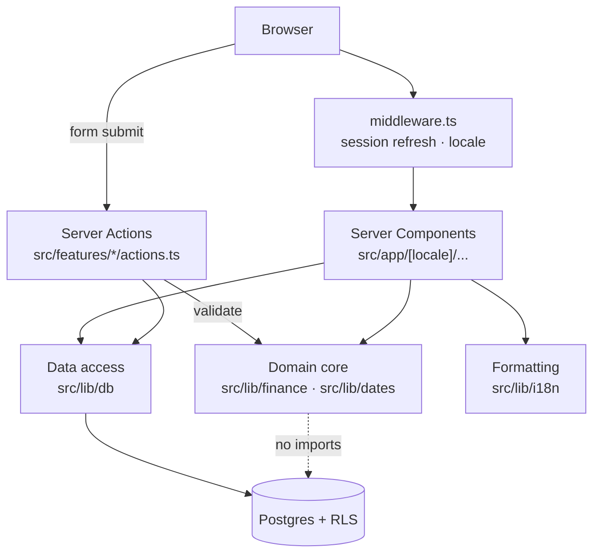

# Architecture

## Layers



The one structural rule: **`src/lib/finance` imports nothing from React, Next
or Supabase.** It is plain TypeScript over plain data. That is what lets 127
unit tests exercise every financial rule without a database, a browser or a
mock, and it is why a UI change cannot alter a calculation.

Three consequences follow, and they are enforced by review rather than by a
tool:

- A component never computes a financial figure. It receives one.
- `src/lib/db` never contains a business rule. It maps rows to domain types and
  back.
- A page never talks to Supabase directly.

## Request flow

**Reading.** A Server Component calls into `src/lib/db`, which issues an
RLS-scoped query. Rows are validated and mapped into domain types, handed to
`src/lib/finance` for aggregation, and the result is formatted by
`src/lib/i18n` for display. No financial value is computed in the browser.

**Writing.** A form posts to a Server Action. The action calls
`requireSession()` for the verified user id, validates the input with Zod and
the domain parsers, writes through `src/lib/db`, then revalidates the affected
routes so balances, budgets and charts are recomputed from the database rather
than patched client-side.

**Middleware** does exactly two things: it refreshes the Supabase session
(Server Components cannot write cookies, so the rotated token would otherwise
be lost) and ensures the URL carries a locale segment. It makes no
authorisation decision — that would be security theatre, since it only sees
requests that pass through the router.

## Directory map

```
src/
  app/
    [locale]/
      (auth)/          sign-in, sign-up — asymmetric two-column shell
      (app)/           authenticated shell: nav, overview, transactions, …
  components/
    charts/            Recharts wrappers; colours validated for CVD
    i18n/              locale provider, language switcher
    navigation/        desktop rail and mobile bar from one typed list
    ui/                the shared primitives, deliberately in one file
  features/
    auth/              sign in/up/out actions and form
    transactions/      CRUD actions, form, list manager
    settings/          preference actions and form
  lib/
    auth/              session resolution
    db/                Supabase reads and writes
    dates/             calendar arithmetic on YYYY-MM-DD strings
    finance/           fixed, money, types, cashflow, budgets, goals, portfolio
    i18n/              config, catalogues, translate, format
    supabase/          clients, env validation, generated types
    routes.ts          href construction
supabase/
  migrations/          schema and RLS, applied in filename order
tests/
  unit/                the calculation layer
  integration/         live Postgres: RLS, triggers, precision
docs/
```

## Key decisions

### Money never touches a float

See [FINANCIAL_CALCULATIONS.md](FINANCIAL_CALCULATIONS.md). Amounts are BigInt
minor units carrying their currency; quantities and prices are fixed-point
BigInts at eight decimals. Columns are read from PostgREST with a `::text` cast
because JSON number serialisation loses the last digit above 2^53 — a fact the
integration suite asserts in both directions.

### Undefined is modelled, not flattened

A savings rate with no income, a budget ratio on a zero limit, the average cost
of a closed position, the value of an unpriced asset: each returns `null` or a
tagged status. The type system then forces the caller to decide what to show,
which is how "—  no income recorded" reaches the screen instead of "0%".

### Transfers are first-class

Four transaction kinds rather than two. Moving money into a savings goal or a
brokerage account changes the cash balance without ever appearing as income or
spending, so saving never reads as overspending.

### Server Actions over API routes

Writes go through Server Actions. There is no REST layer to keep in sync, the
validation code is shared, and the user id comes from the verified session
rather than the request body. An Express backend would add a deployment target
and a serialisation boundary for no capability this product needs.

### No state-management library

Server Components hold the data; `useActionState` holds form state; the URL
holds filters and the locale. A global store would duplicate the database in
the browser and introduce the possibility of the two disagreeing — which, in a
finance application, means showing a balance that is not the balance.

### What was deliberately not used

| Not used | Why |
|---|---|
| `cacheComponents` | Every authenticated route is request-bound through cookies |
| `typedRoutes` | Every href sits under a dynamic `[locale]`; it forces casts that defeat the checking |
| A date library | Calendar arithmetic on date strings is ~120 lines and avoids timezone surprises |
| A component library | The editorial look is the product; adopting someone else's defaults works against it |
| `next-intl` | Two locales and `Intl` cover the need; the catalogue is type-checked in-house |

## Design system

Tokens live in `src/app/globals.css` as a Tailwind v4 theme. Two rules in there
came from measurement rather than taste and are commented so they are not
"tidied up" later:

1. **White on olive is 1.8:1.** Text on olive or clay is always ink (7.8:1).
   Semantic text colours were darkened to olive `#5A6B45` and clay `#8A5A3C`,
   both ~5.3:1 on paper.
2. **The hairline divider is 1.2:1.** Fine for a decorative rule, a WCAG 1.4.11
   failure for a control edge — so interactive borders use a separate
   `line-strong` token at 3.2:1.

Chart colours were chosen by running a palette validator. The obvious pairing —
the palette's own olive against its clay — measured ΔE 2.4 under deuteranopia,
meaning a red-green colourblind reader could not tell income from expenses.
The shipped pair measures 11.9 (protan) and 25.6 (normal vision), and colour is
still never the only signal: a legend is always present and the figures are
available as a table.

Composition is editorial rather than card-based: sections separated by rules,
asymmetric layouts, large figures with tabular numerals so a balance does not
shift sideways as its digits change. Motion is limited to short entrances and
state transitions, and `prefers-reduced-motion` is honoured globally.

## Internationalisation

The Turkish catalogue defines the message shape; English is typed against it,
so a missing key fails the build rather than rendering blank. Amounts are
handed to `Intl` as decimal strings — verified to preserve precision past
`Number.MAX_SAFE_INTEGER` — and fraction digits come from Daylight's own
currency table, since `Intl` renders XAU with two decimals while the schema
stores four. Calendar dates are pinned to UTC noon before formatting so no
timezone can shift the day.
