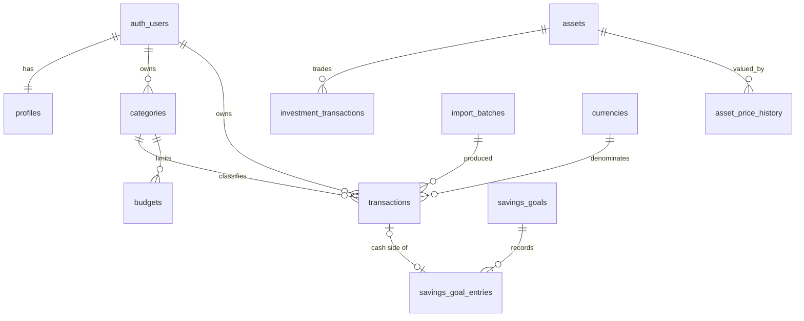

# Database

Postgres 17 via Supabase. Schema and policies live in `supabase/migrations/`
and are applied in filename order. Both migrations have been applied to a live
local database without error.

## Conventions

| Concern | Choice | Why |
|---|---|---|
| Money | `BIGINT` minor units + `CHAR(3)` currency | An integer cannot drift; the currency travels with the amount |
| Quantities, prices | `NUMERIC(28,8)` | Eight decimals covers satoshi-level crypto and fractional lots |
| User-entered dates | `DATE` | A calendar day in the user's timezone, not an instant |
| Audit timestamps | `TIMESTAMPTZ` | These *are* instants |
| Ownership | `user_id` + `ON DELETE CASCADE` | Deleting an account removes its records |
| Identifiers | `UUID` via `gen_random_uuid()` | Not guessable, not enumerable |

Currencies are a **table**, not an enum, so adding one is a data row rather
than a migration, and each code carries its own exponent.

## Tables

### `profiles`
One row per auth user, created by the `on_auth_user_created` trigger so the
application never meets a signed-in user without a profile.

| Column | Type | Notes |
|---|---|---|
| `id` | uuid PK | references `auth.users` |
| `display_name` | text | ≤ 80 chars |
| `locale` | text | `tr` or `en` |
| `default_currency` | char(3) | **display default only** — never rewrites existing records |
| `time_zone` | text | decides what "today" and "this month" mean |

### `categories`
| Column | Type | Notes |
|---|---|---|
| `kind` | enum | `income` or `expense` — a category belongs to one side |
| `is_system` | boolean | seeded starters |
| `system_key` | text | stable key (`groceries`), used to show a translated label |

Unique on `(user_id, kind, lower(trim(name)))`, so "Food" and " food " cannot
both exist, while "Transport" may legitimately exist as both an income and an
expense category.

`system_key` exists because the interface is bilingual: a seeded category shows
a translated label, and a category the user created or renamed is shown exactly
as they typed it. Translating a user's own words would be wrong; leaving an
English seed label in a Turkish interface would be sloppy.

### `transactions`
| Column | Type | Notes |
|---|---|---|
| `kind` | enum | `income`, `expense`, `transfer_in`, `transfer_out` |
| `amount_minor` | bigint | `CHECK (> 0)` — direction comes from `kind`, never the sign |
| `currency` | char(3) | FK to `currencies` |
| `occurred_on` | date | the user's calendar date |
| `category_id` | uuid | `ON DELETE SET NULL` — deleting a category must not delete history |
| `goal_id`, `asset_id` | uuid | provenance links to the savings or investment side |
| `import_batch_id` | uuid | which CSV import produced this row |
| `import_fingerprint` | text | duplicate detection on re-import |

Indexes:

| Index | Serves |
|---|---|
| `(user_id, occurred_on desc, id desc)` | the listing and every period aggregate |
| `(user_id, kind, occurred_on)` | income/expense totals |
| `(user_id, category_id, occurred_on)` partial | budget lookups |
| GIN trigram on `description` | search |

Storing amounts as strictly positive with a directional `kind` is what makes a
negative income row — the classic double-counting bug — unrepresentable.

### `budgets`
One per category per month, enforced by a unique constraint. `period_start` has
`CHECK (extract(day from period_start) = 1)`, so period arithmetic cannot drift
onto a mid-month boundary. `limit_minor` must be positive.

### `savings_goals`, `savings_goal_entries`
Goals carry a target, an optional target date and an `archived_at` so history
survives instead of being deleted. Entries are directional (`deposit` /
`withdrawal`) and may reference the cash `transaction_id` that accompanied
them.

A trigger rejects an entry whose currency differs from its goal, and also
rejects an entry pointing at a goal owned by another user — a second line of
defence behind the RLS policy.

### `assets`, `investment_transactions`, `asset_price_history`
An asset declares the currency it trades in; triggers enforce that its trades,
fees and prices all match. A price carries `as_of` and a `source` (`manual`
today), so a future market-data provider is another source value rather than a
schema change — and so a three-week-old valuation can be disclosed as such.

`investment_transactions` is indexed on `(asset_id, occurred_on, id)`, which is
exactly the order the cost-basis replay needs.

### `import_batches`
Records each CSV import with row counts, a status and a JSONB `error_report`,
so a partial import can explain which rows were rejected and why. The table
exists; the import workflow does not yet.

## Relationships

## User isolation

Every user-owned table has RLS enabled with policies keyed on `auth.uid()`.
The user id is never accepted from the client.

Beyond the obvious `user_id = auth.uid()`:

- **`WITH CHECK` on insert and update.** Without it a user could reassign one
  of their rows to another `user_id`, or insert a row pre-labelled with a
  victim's id.
- **Parent ownership verified.** A foreign key alone would let a user attach
  their transaction to someone else's category, or their trade to someone
  else's asset. The policies carry an `EXISTS` clause confirming the parent
  belongs to the caller.

`tests/integration/isolation.test.ts` attempts each of these breaches against a
live database with two real users and the anon key, and asserts that they fail.
See [SECURITY.md](SECURITY.md) for what remains untested.

## Migrations

| File | Contents |
|---|---|
| `20261019090000_initial_schema.sql` | Extensions, enums, currencies, all tables, indexes, currency-guard and `updated_at` triggers |
| `20261019090100_rls_policies.sql` | RLS on every table, policies, and the new-user bootstrap trigger |

Add a new file for every change; never edit one that has been applied.
`npm run db:reset` rebuilds the local database from scratch and destroys local
data — it is never run against a deployed database.

`npm run db:types` regenerates `src/lib/supabase/database.types.ts` from the
live schema. Note that the generator maps `BIGINT` and `NUMERIC` to the
TypeScript `number`, which cannot hold them exactly; the data access layer
compensates with `::text` casts, and the generated file carries a header saying
so.

## Seed data

`supabase/seed.sql` is intentionally absent. Demo data is inserted through the
API as a normal user so that it passes the same RLS policies and constraints as
real input — seeding around the policies would prove nothing about whether they
work. All demo figures are synthetic; no real person's financial data appears
in this repository.
